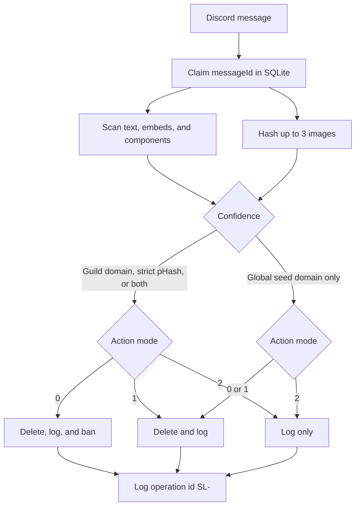

<div align="center">

# Scam Lens for Discord

Open-source Discord scam detection bot for phishing links and scam images. Self-host it, tune what happens on a hit, and keep new servers in log-only mode until you trust the results.

Scam Lens checks hostnames against a blocklist of about 21,900 known Discord phishing domains[^blocklist] and matches message images with perceptual hashes (pHash). One Node.js process, discord.js, and SQLite. MIT licensed.

[](https://github.com/vorlaxen-labs/scam-lens-for-discord/actions/workflows/ci.yml)
[](LICENSE)
[](package.json)
[](https://discord.js.org)

[Add to Discord](https://discord.com/oauth2/authorize?client_id=1538177155316322445&permissions=1099511654404&scope=bot+applications.commands&integration_type=0) · [Setup](docs/setup.md) · [Self-hosting](docs/self-hosting.md) · [Architecture](docs/architecture.md) · [Contributing](CONTRIBUTING.md) · [Security](SECURITY.md) · [Changelog](CHANGELOG.md) · [Issues](https://github.com/vorlaxen-labs/scam-lens-for-discord/issues)

</div>

> [!IMPORTANT]
> Enable the **Message Content** privileged intent. Without it the bot cannot read message text, so phishing URLs are invisible.

## Contents

- [What it catches](#what-it-catches)
- [How detection works](#how-detection-works)
- [Quick start](#quick-start)
- [Commands](#commands)
- [Safe defaults](#safe-defaults)
- [Limitations](#limitations)
- [Stack](#stack)
- [Self-hosting](#self-hosting)
- [FAQ](#faq)
- [License](#license)

## What it catches

- **Phishing domains.** Suffix match against the seeded blocklist.[^blocklist] A global seed hit deletes and logs. Auto-ban stays off for that case.
- **Scam images.** Perceptual hash of up to three image attachments per message. Animated images use the first frame only. Hamming distance decides a normal hit versus a strict hit.
- **Server-specific rules.** Add your own domains and image hashes, or allowlist a trusted domain so it skips the blocklist.

> [!NOTE]
> A domain you add for that server, a strict pHash match, or both together are the only high-confidence hits. Those are the hits that can ban, and only in action mode `0`.

## How detection works



Timeout, when enabled with `/config timeout`, runs on every detection and is skipped when a ban is issued. Each log line carries a ULID operation id (`SL-...`) for `/config restore`.

Full runtime notes: [docs/architecture.md](docs/architecture.md).

## Quick start

About five minutes once the Discord application exists. Portal clicks, intents, and the invite URL: [docs/setup.md](docs/setup.md).

- [ ] Create the application, copy the bot token and application id, and enable Message Content intent
- [ ] Copy the env file and fill `BOT_TOKEN` and `BOT_CLIENT_ID`
- [ ] Install dependencies and start the bot
- [ ] [Invite the bot](https://discord.com/oauth2/authorize?client_id=1538177155316322445&permissions=1099511654404&scope=bot+applications.commands&integration_type=0) (Manage Messages, Ban Members, Moderate Members, Send Messages, Embed Links only), set `/config log-channel`, and dry-run a URL with `/config test` before leaving log-only mode

```bash
git clone https://github.com/vorlaxen-labs/scam-lens-for-discord.git
cd scam-lens-for-discord
cp env/.env.example env/.env.development
# Edit BOT_TOKEN and BOT_CLIENT_ID
pnpm install
pnpm dev
```

> [!TIP]
> New guilds already start in log-only mode (`2`). Watch the log channel, then switch to delete-and-log with `/config action mode:1`.

Production, Docker Compose, and Coolify: [docs/self-hosting.md](docs/self-hosting.md).

## Commands

| Command | Purpose |
|---------|---------|
| `/about` | Version, domain count, hash count, and this server's settings |
| `/config` | Log channel, action mode, thresholds, timeout, restore, and a dry-run test |
| `/get-hash` | Perceptual hash of an attached image |
| `/add-scam` / `/remove-scam` | Guild scam image hashes |
| `/add-domain` / `/remove-domain` / `/list-domains` | Guild blocked domains |
| `/add-allow-domain` / `/remove-allow-domain` / `/list-allow-domains` | Domains that bypass the blocklist |

<details>
<summary><code>/config</code> subcommands</summary>

| Subcommand | What it sets |
|------------|----------------|
| `log-channel` | Guild text channel for detection logs |
| `status` | Current settings for this server |
| `enabled` | Turn detection on or off |
| `action` | Mode `0`, `1`, or `2` |
| `threshold` | pHash distance for delete-and-log, from 1 to 20 |
| `strict-threshold` | pHash distance for high confidence, from 1 to 10 |
| `timeout` | `enabled` and `duration` in seconds, from 60 to 604800 |
| `skip-bots` | Skip messages sent by other bots |
| `test` | Scan text or a URL and take no action |
| `restore` | Unban and clear timeout. Optional `operation_id` (`SL-...`) |

```text
/config timeout enabled:true duration:3600
/config test text:https://example-scam-domain.test
```

</details>

## Safe defaults

- New servers start in **log-only mode (2)** until you configure actions.
- Production default action: **delete + log (1)**.
- **Timeout** is independent of action mode. Enable it per server with `/config timeout`.
- Auto-ban only on a **guild-added domain**, a **strict pHash** match, or a **dual signal**.
- A global seed domain deletes and logs. Auto-ban stays off, which cuts false positives from the third-party list.
- `/add-allow-domain` exempts a trusted domain. `/config restore` undoes a false positive.

### Action modes (`/config action`)

| Mode | On detection | High confidence |
|------|--------------|-----------------|
| `0` | Delete + log | Ban |
| `1` | Delete + log | — *(recommended default)* |
| `2` | Log only | — *(new servers)* |

> [!CAUTION]
> Action mode `0` bans the member on a high-confidence hit. Stay on mode `2` or `1` until the log channel matches what you expect.

## Limitations

- Scans **new guild messages** only. Direct messages and messages sent before the bot joined are outside the scanner.
- Image matching is a **perceptual hash** against the seeded set and hashes you add for that server. A hit means the attachment is close to a known screenshot.
- At most **three** image URLs per message. Animated images use the **first frame**.
- A hit that is only on the global seed list **deletes and logs**. Auto-ban stays off for that case.
- The domain list is a [third-party snapshot](data/text/SOURCES.md). There is no update SLA.
- **One process, one SQLite file.** A second process on the same file will diverge.
- You run the bot yourself. Guild data stays in your SQLite file.

## Stack

| Component | Role |
|-----------|------|
| **SQLite** | Source of truth — domains, hashes, settings, logs |
| **In-memory blocklist** | Hot-path domain set (~21,900 entries, suffix lookup) |
| **Node.js 22+ and discord.js 14** | Bot runtime |
| **pHash** | Scam image matching |

> [!WARNING]
> One process owns the SQLite file. A second bot process on the same file will diverge. Keep Coolify and Docker replicas at 1. See [docs/architecture.md](docs/architecture.md).

## Self-hosting

Node.js 22 or newer and pnpm. On first start the bot seeds `domains.txt` and loads `data/image-hashes.csv` into SQLite. It does not re-hash `data/images/` on boot. After you add or replace a reference screenshot:

```bash
pnpm build:image-dataset
```

<details>
<summary>Environment variables</summary>

Names and defaults match [`env/.env.example`](env/.env.example) and [`src/config/index.ts`](src/config/index.ts).

| Variable | Required | Role |
|----------|----------|------|
| `BOT_TOKEN` | yes | Bot token |
| `BOT_CLIENT_ID` | yes | Application id |
| `BOT_GUILD_ID` | dev only | Guild slash-command sync. Leave empty in production |
| `DATABASE_PATH` | no | Default `./data/scam-lens.db` |
| `SCAM_ACTION` | no | Default `1`. New guilds still start in mode `2` until an admin changes them |
| `PHASH_THRESHOLD` | no | Default `8` |
| `PHASH_STRICT_THRESHOLD` | no | Default `3` |
| `TIMEOUT_DURATION_SECONDS` | no | Default `3600` for new guild records |
| `LOG_CHANNEL_ID` | no | Optional central hub channel for every server |
| `TELEMETRY_ENABLED` | no | Default `true`. Ops events in the process log |
| `TELEMETRY_GUILD_EVENTS` | no | Default `true` |
| `TELEMETRY_COMMANDS` | no | Default `false` |
| `OWNER_IDS` | no | Comma-separated Discord user ids |
| `GITHUB_REPO_URL` | no | Link on `/about`. Use this repository, or your fork |
| `PRESENCE_ENABLED` | no | Default `true` |
| `PRESENCE_ROTATE_MS` | no | Default `45000` |
| `INSTALL_SYNC_ENABLED` | no | Default `true`. Keeps the profile **Add App** invite in sync |
| `BOT_INVITE_URL` | no | Optional invite override. Otherwise built from `BOT_CLIENT_ID` |

</details>

## FAQ

### How does this Discord bot detect scam images?

It computes a perceptual hash (pHash) for image attachments and compares it to known scam hashes with Hamming distance. `/config threshold` sets the delete-and-log sensitivity (1–20). `/config strict-threshold` sets the stricter distance used for high-confidence actions (1–10). `/get-hash` shows the hash for an attachment you upload. `/add-scam` stores a hash for that server only.

### Does it block Discord phishing links?

Yes. Message text, embeds, and components are scanned for hostnames. A hostname matches when it equals a blocked domain or is a subdomain of one. The seeded list is about 21,900 domains.[^blocklist] Each server can add more domains or allowlist ones that should pass.

### Can I self-host this Discord scam bot?

Yes. Clone [vorlaxen-labs/scam-lens-for-discord](https://github.com/vorlaxen-labs/scam-lens-for-discord), set `BOT_TOKEN` and `BOT_CLIENT_ID`, then run `pnpm dev` or the production Docker compose file in [docs/self-hosting.md](docs/self-hosting.md). Data stays in a local SQLite file. This repository does not ship a hosted multi-tenant service.

### Will Scam Lens ban members automatically?

Only in action mode `0`, and only for a high-confidence hit: a domain that server added, a strict pHash match, or a dual signal. A hit that is only on the global seed list deletes and logs. New servers start in mode `2` (log only). Turn on deletes with `/config action mode:1` after you have watched the log channel.

### What Discord permissions and intents does it need?

Privileged intent: **Message Content** (required). Server Members is recommended for ban and timeout. OAuth scopes: `bot` and `applications.commands`. Bot permissions: Manage Messages, Ban Members, Moderate Members, Send Messages, and Embed Links (`1099511654404`). [Add to Discord](https://discord.com/oauth2/authorize?client_id=1538177155316322445&permissions=1099511654404&scope=bot+applications.commands&integration_type=0). Setup checklist: [docs/setup.md](docs/setup.md).

### Does one database work across multiple bot processes?

No. One SQLite file belongs to one process. A second instance against the same file will diverge. Shared storage for more than one process is not available. See [docs/architecture.md](docs/architecture.md).

## Maintenance

Blocklist sync and dependency updates are actively maintained. See [CHANGELOG.md](CHANGELOG.md) and [Releases](https://github.com/vorlaxen-labs/scam-lens-for-discord/releases). CI workflow: [.github/workflows/ci.yml](.github/workflows/ci.yml). Bug reports: [Issues](https://github.com/vorlaxen-labs/scam-lens-for-discord/issues).

## License

MIT — see [LICENSE](LICENSE). Third-party domain list attribution: [NOTICE](NOTICE). Branding credit is appreciated and not required: [BRANDING.md](BRANDING.md).

[Contributing](CONTRIBUTING.md) · [Security](SECURITY.md) · [Code of conduct](CODE_OF_CONDUCT.md)

Created by [Vorlaxen Labs](https://vorlaxen.com).

[^blocklist]: Seeded from [nikolaischunk/discord-phishing-links](https://github.com/nikolaischunk/discord-phishing-links) (`txt/domain-list.txt`, about 21,900 domains). Update policy: [data/text/SOURCES.md](data/text/SOURCES.md).
